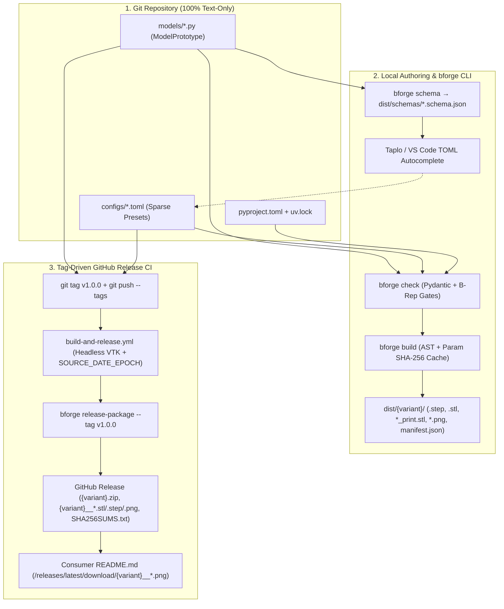
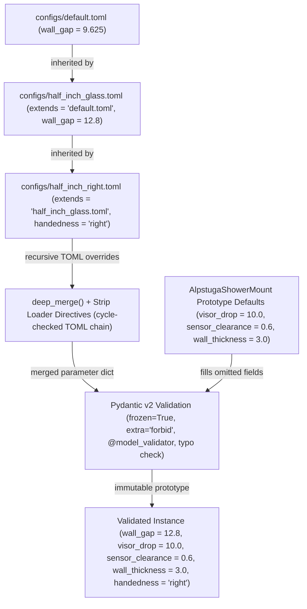
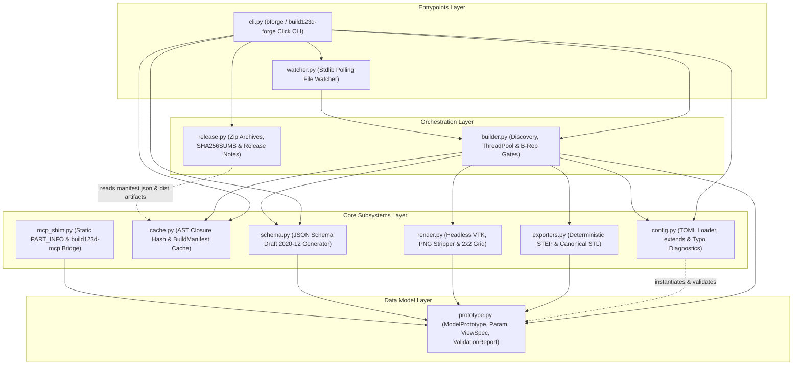
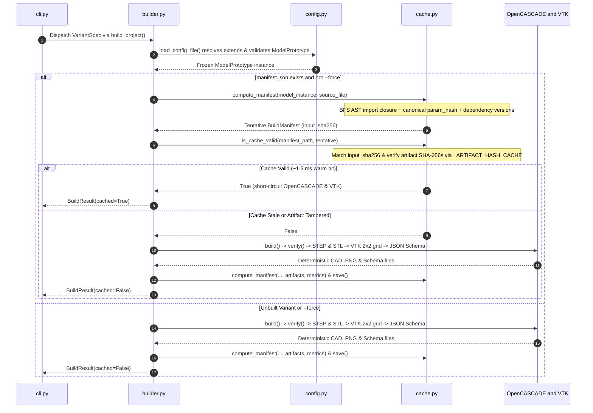

# build123d-forge

[](https://github.com/build123d-forge/build123d-forge/actions/workflows/ci.yml)
[](https://github.com/build123d-forge/build123d-forge/actions/workflows/build-and-release.yml)
[](https://www.python.org/)
[](https://github.com/gumyr/build123d)
[](https://docs.pydantic.dev/latest/)
[](https://github.com/build123d-forge/build123d-forge/blob/main/LICENSE)

**Declarative, schema-driven parametric CAD configurations, bit-for-bit reproducible exports, content-addressed caching, and automated GitHub Releases for [`build123d`](https://github.com/gumyr/build123d) models.**

---

## Table of Contents

- **User Guide**
  - [Why `build123d-forge`?](#why-build123d-forge)
  - [End-to-End Workflow](#end-to-end-workflow)
  - [Installation & Consumer Project Structure](#installation--consumer-project-structure)
  - [User Guide & Examples](#user-guide--examples)
    - [1. Declaring a `ModelPrototype`](#1-declaring-a-modelprototype)
    - [2. Exporting Draft 2020-12 JSON Schemas & IDE Autocomplete](#2-exporting-draft-2020-12-json-schemas--ide-autocomplete)
    - [3. Sparse `.toml` Configurations, Inheritance & Typo Diagnostics](#3-sparse-toml-configurations-inheritance--typo-diagnostics)
    - [4. Interactive Authoring in `build123d-mcp` with `mcp_shim`](#4-interactive-authoring-in-build123d-mcp-with-mcp_shim)
  - [`bforge` CLI Reference](#bforge-cli-reference)
  - [Automated GitHub Releases & Embedding Release Previews](#automated-github-releases--embedding-release-previews)
- **Developer & Architecture Guide**
  - [Architecture Overview](#architecture-overview)
  - [Internals Deep Dive](#internals-deep-dive)
  - [Development Setup](#development-setup)
  - [Testing Architecture & Writing Future Tests](#testing-architecture--writing-future-tests)

---

## Why `build123d-forge`?

Sharing parametric 3D-printable hardware in Git usually forces an uncomfortable trade-off:

- **Committing binary `.stl`, `.step`, and `.png` files** bloats repository history by megabytes on every parameter tweak, produces opaque diffs in pull requests, and silently drifts out of sync when someone edits Python geometry without re-exporting every preset.
- **Committing only procedural `.py` scripts** keeps Git clean, but forces casual makers who just want to slice a part to install Python, OpenCASCADE, and `build123d`—while scattering magic numbers without machine-readable parameter bounds, physical units, or print-bed orientations.

`build123d-forge` treats parametric CAD like modern software release engineering:

| Capability | Traditional CAD-in-Git | `build123d-forge` |
| :--- | :--- | :--- |
| **Git Repository Contents** | Binary `.stl` / `.step` / `.png` churn in commits | **100% text-only**: `models/*.py` + sparse `configs/*.toml` |
| **Parameter Validation** | Ad-hoc globals or runtime OpenCASCADE crashes | **Pydantic v2 `ModelPrototype`** (`frozen=True`, `extra="forbid"`, `Param(..., unit="mm")`, `@model_validator` invariants) |
| **Preset Authoring** | Copy-pasted scripts per size variant | **Sparse `.toml` presets** with cycle-checked `extends` inheritance, Taplo/VS Code JSON Schema autocomplete, and fuzzy typo hints |
| **Geometry QA** | Manual visual inspection | **Automated B-Rep gates** (`bforge check`) verifying solid validity, manifoldness, watertightness, and positive volume |
| **Build Determinism & Speed** | Non-deterministic STEP timestamps & full rebuilds | **Bit-for-bit reproducible** `.step`, `.stl`, `*_print.stl`, and `.png` outputs with **sub-5 ms AST + parameter SHA-256 caching** |
| **End-User Distribution** | Manual local exports uploaded by hand | **Tag-driven GitHub Releases** (`v*`) publishing `.stl`, `.step`, `.png`, `.zip`, `RELEASE_NOTES.md`, and `SHA256SUMS.txt`—powering live `README.md` previews |

> **Live Reference Project:** See [`build123d-forge/alpstuga-shower-mount`](https://github.com/build123d-forge/alpstuga-shower-mount) for a complete production hardware repository built and published with `build123d-forge`.

---

## End-to-End Workflow



1. **Author purely in text**: Define parametric geometry as a `ModelPrototype` in `models/*.py` and capture each hardware variation (e.g., `default.toml`, `half_inch_glass.toml`) as a sparse `.toml` preset in `configs/`.
2. **Validate & iterate locally**: Export Draft 2020-12 JSON Schemas (`bforge schema`) for live editor autocomplete, run `bforge check` to enforce parameter invariants and watertight B-Rep geometry, and run `bforge build` (or `bforge watch`) to compile deterministic CAD and shaded VTK previews into git-ignored `dist/<variant>/`.
3. **Tag to publish**: Push a `v*` tag (`git tag v1.0.0 && git push origin v1.0.0`). The reusable GitHub Actions workflow builds every variant in headless Linux, uploads release archives and flattened `<variant>__<asset>` files with SHA-256 checksums, and automatically serves up-to-date images and slicer downloads in your repository's `README.md`.

---

## Installation & Consumer Project Structure

### Installing `build123d-forge`

`build123d-forge` requires **Python `>= 3.11`** and installs both the `bforge` and `build123d-forge` CLI entry points.

#### Using `uv` (Recommended)

```bash
# Install from PyPI (include [render] for optional resvg-py SVG fallback support)
uv pip install "build123d-forge[render]"

# Or add directly to a consumer project's pyproject.toml & uv.lock
uv add "build123d-forge[render]"

# Or install directly from GitHub main
uv pip install "build123d-forge[render] @ git+https://github.com/build123d-forge/build123d-forge.git"
```

#### Using `pip`

```bash
# Install from PyPI
pip install "build123d-forge[render]"

# Or install directly from GitHub main
pip install "build123d-forge[render] @ git+https://github.com/build123d-forge/build123d-forge.git"
```

### Consumer `pyproject.toml` Configuration

Configure your parametric hardware repository with a standard `pyproject.toml` and optional `[tool.build123d_forge]` search paths:

```toml
[project]
name = "alpstuga-shower-mount"
version = "0.2.0"
description = "Symmetric parametric over-the-glass shower mount for the IKEA ALPSTUGA sensor"
readme = "README.md"
requires-python = ">=3.11"
dependencies = [
    "build123d>=0.13.0",
    "build123d-forge[render]>=0.1.0",
]

[tool.build123d_forge]
models = ["models"]
configs = ["configs"]
```

- **`models`**: Directories (or `.py` file paths) scanned recursively for concrete `ModelPrototype` subclasses. If omitted, `bforge` auto-discovers `models/`, `parts/`, or the project root (automatically excluding `tests/`, `test_*.py`, `*_test.py`, `.venv/`, and `dist/`).
- **`configs`**: Directories (or `.toml` file paths) scanned for configuration presets. If omitted, `bforge` auto-discovers `configs/` or the project root (excluding `pyproject.toml`). If a project has no `.toml` files yet, `bforge` synthesizes a `default` variant directly from the prototype's parameter defaults.

### Recommended Consumer Project Layout

```text
alpstuga-shower-mount/
├── pyproject.toml                  # Dependencies & [tool.build123d_forge] layout
├── uv.lock                         # Locked dependencies for reproducible CI builds
├── README.md                       # Links /releases/latest/download/<variant>__*
├── .gitignore                      # Ignores dist/, release_assets/, .venv/
├── .github/
│   └── workflows/
│       └── release.yml             # Calls reusable build-and-release.yml@main
├── models/                         # Declarative ModelPrototype sources (committed)
│   └── alpstuga_shower_mount.py
├── configs/                        # Sparse .toml parameter presets (committed)
│   ├── default.toml                # 3/8" glass baseline -> dist/default/
│   └── half_inch_glass.toml        # extends = "default.toml" -> dist/half_inch_glass/
├── resources/                      # Optional reference 3D scans, datasheets, mating STEP parts
│   └── alpstuga.step
└── dist/                           # Generated locally by `bforge` (git-ignored)
    ├── schemas/
    │   └── AlpstugaShowerMount.schema.json
    ├── default/
    │   ├── alpstuga_shower_mount.step
    │   ├── alpstuga_shower_mount.stl
    │   ├── alpstuga_shower_mount_print.stl
    │   ├── iso_shower.png, iso_rear_clip.png, bottom_airflow.png, print_bed.png
    │   ├── preview_grid.png
    │   └── manifest.json
    └── half_inch_glass/
        └── ...
```

Add generated build and release directories to your `.gitignore`:

```gitignore
dist/
release_assets/
.venv/
__pycache__/
```

---

## User Guide & Examples

### 1. Declaring a `ModelPrototype`

Every parametric part or assembly subclasses `ModelPrototype`—an immutable (`frozen=True`), strict (`extra="forbid"`, `validate_default=True`) Pydantic v2 `BaseModel` tailored for `build123d`.

```python
# models/glass_mount.py
"""Parametric over-the-glass sensor mount."""

from typing import Literal, Self

from build123d import Align, Axis, Box, BuildPart, Locations, Mode, Part, Plane, mirror
from pydantic import model_validator

from build123d_forge import ModelPrototype, Param, ViewSpec, mcp_shim


class GlassMount(ModelPrototype):
    """Parametric U-channel glass mount with configurable slot gap and handedness."""

    # Optional domain synonyms for typo diagnostics in TOML presets
    __synonyms__ = {"glass_thickness": "wall_gap", "slot_width": "wall_gap"}

    wall_gap: float = Param(
        9.625,
        gt=0.0,
        unit="mm",
        description="Glass wall slot gap in mm (3/8 in = 9.525 mm + 0.1 mm clearance)",
    )
    visor_drop: float = Param(
        10.0,
        gt=0.0,
        unit="mm",
        description="Vertical engagement depth over the top edge of the glass",
    )
    wall_thickness: float = Param(
        3.0,
        ge=1.2,
        unit="mm",
        description="Structural wall and roof thickness",
    )
    mount_width: float = Param(
        60.0,
        gt=10.0,
        unit="mm",
        description="Overall width along the glass pane",
    )
    handedness: Literal["left", "right"] = Param(
        "left",
        description="Glass wall side when viewing from inside ('left' or 'right')",
    )

    @model_validator(mode="after")
    def _check_geometric_invariants(self) -> Self:
        """Reject unbuildable or fragile parameter combinations before CAD execution."""
        if self.visor_drop < 2.0 * self.wall_thickness:
            raise ValueError(
                f"visor_drop ({self.visor_drop} mm) must be at least 2x "
                f"wall_thickness ({self.wall_thickness} mm) for clip strength."
            )
        return self

    def build(self) -> Part:
        """Construct and return the upright functional B-Rep Part solid."""
        outer_x = self.wall_gap + 2.0 * self.wall_thickness
        outer_z = self.visor_drop + self.wall_thickness

        with BuildPart() as bp:
            Box(
                outer_x,
                self.mount_width,
                outer_z,
                align=(Align.MIN, Align.CENTER, Align.MIN),
            )
            with Locations((self.wall_thickness, 0.0, 0.0)):
                Box(
                    self.wall_gap,
                    self.mount_width + 1.0,
                    self.visor_drop,
                    align=(Align.MIN, Align.CENTER, Align.MIN),
                    mode=Mode.SUBTRACT,
                )

        part = bp.part
        if self.handedness == "right":
            part = mirror(part, about=Plane.XZ)
        part.label = "glass_mount"
        return part

    def orient_for_print(self, part: Part | None = None) -> Part:
        """Flip upside-down onto the flat top roof (Z = 0) for zero-support FDM printing."""
        if part is None:
            part = self.build()
        total_z = self.visor_drop + self.wall_thickness
        oriented = part.rotate(Axis.X, 180.0).translate((0.0, 0.0, total_z))
        oriented.label = "glass_mount_print_oriented"
        return oriented

    def views(self) -> list[ViewSpec]:
        """Camera suite rendered to PNGs and composited into preview_grid.png."""
        return [
            ViewSpec(
                stem="iso_front",
                description="Isometric front view",
                direction="front",
                azimuth=35.0,
                elevation=25.0,
            ),
            ViewSpec(
                stem="iso_rear",
                description="Isometric rear view",
                direction="front",
                azimuth=145.0,
                elevation=25.0,
            ),
            ViewSpec(
                stem="side_slot",
                description="Glass slot profile view",
                direction="side",
                azimuth=0.0,
                elevation=0.0,
            ),
            ViewSpec(
                stem="print_bed",
                description="Inverted zero-support print bed orientation",
                direction="iso",
                azimuth=35.0,
                elevation=30.0,
                use_print_oriented=True,
            ),
        ]


GlassMount.model_rebuild()
mcp_shim(GlassMount, globals())
```

#### Key `ModelPrototype` Hooks & Primitives

- **`Param(default=..., *, unit=None, description=None, gt=None, ge=None, lt=None, le=None, ...)`**: Thin wrapper around `pydantic.Field` that attaches physical units (`json_schema_extra={"unit": unit}`) alongside numeric constraints and descriptions—propagating them into JSON Schemas, scaffolded `.toml` comments, and `PART_INFO` dictionaries.
- **`@model_validator(mode="after")`**: Standard Pydantic v2 validator for cross-parameter geometric rules (e.g., ensuring clearances, minimum wall ratios, or hole-to-edge margins before OpenCASCADE runs).
- **`build(self) -> Part | dict[str, Part]`** *(required)*:
  - Returning a single `Part` exports `<slug>.step` and `<slug>.stl` (where `<slug>` uses `part.label` if set, otherwise the Python source stem or `snake_case` class name).
  - Returning a `dict[str, Part]` (for multi-part assemblies) exports a combined `<slug>.step` `Compound` plus individual `<slug>_<part_key>.stl` meshes.
- **`orient_for_print(self, part: Part | None = None) -> Part | dict[str, Part] | None`** *(optional)*: Transforms the built geometry into its optimal slicer orientation at `Z = 0` and triggers `<slug>_print.stl` generation. Returning `None` (the default) skips `*_print.stl` export.
- **`views(self) -> list[ViewSpec]`** *(optional)*: Defines offscreen Phong-shaded VTK renders (`1000 × 750` px, stripped metadata chunks). Defaults to a 4-view suite (`iso`, `top`, `side`, and print-oriented `bed`). When 4 or more `ViewSpec` entries are returned, `bforge build` also composites the first 4 into a `2 × 2` `preview_grid.png`.
  - `ViewSpec` fields: `stem` (output `<stem>.png` filename), `description`, `direction` (`"front"`, `"iso"`, `"top"`, `"bottom"`, `"side"`/`"right"`, `"left"`, `"back"`/`"rear"`), `azimuth` (degrees), `elevation` (degrees), and `use_print_oriented` (`bool`, renders the `orient_for_print()` solid when `True`).
- **`verify(self, shape)` & `from_toml(path)`**: Built-in B-Rep verification gate (returning a `ValidationReport` with `is_valid`, `is_manifold`, `watertight`, `solids`, `faces`, `volume_mm3`, and `bounding_box_mm`) and programmatic TOML loader (`mount = GlassMount.from_toml("configs/default.toml")`).

---

### 2. Exporting Draft 2020-12 JSON Schemas & IDE Autocomplete

Generate Draft 2020-12 JSON Schemas (`https://json-schema.org/draft/2020-12/schema`) for every `ModelPrototype` in your project:

```bash
bforge schema
# Exported schema: /path/to/project/dist/schemas/GlassMount.schema.json
```

*(Note: `bforge build` also keeps `dist/schemas/<Model>.schema.json` updated automatically.)*

Each generated schema enforces `additionalProperties: false` while exposing parameter types, `default` values, numeric bounds (`exclusiveMinimum`, `minimum`, `maximum`), `Literal` enum choices, physical `"unit"` annotations, and the `extends` / `model` loader directives.

#### Enabling Taplo / VS Code Autocomplete

1. Install **[Even Better TOML](https://marketplace.visualstudio.com/items?itemName=tamasfe.even-better-toml)** in VS Code (or configure the `taplo` language server in Neovim, Zed, or JetBrains IDEs).
2. Place the `#:schema` directive on line 1 of your `.toml` preset (`bforge new-config` adds this header automatically):

```toml
#:schema ../dist/schemas/GlassMount.schema.json

wall_gap = 9.625
handedness = "left"
```

With the `#:schema` directive active, your editor provides:
- **Key completion (`Ctrl+Space`)** for every `ModelPrototype` parameter and loader directive (`extends`, `model`).
- **Hover documentation** showing descriptions, defaults, bounds, and units.
- **Instant inline diagnostics** if you type an unknown parameter name, violate `gt = 0.0`, or pass an invalid `Literal` choice—before running a single CLI command.

---

### 3. Sparse `.toml` Configurations, Inheritance & Typo Diagnostics

#### Scaffolding a Documented Preset

Use `bforge new-config` to scaffold a fully documented preset in `configs/`:

```bash
bforge new-config default
```

This writes `configs/default.toml` with the `#:schema` header, class docstring, field descriptions, `[unit]` tags, constraint bounds, and default values.

#### Sparse Overrides & `extends` Inheritance

You never need to repeat unchanged parameters across presets. Any `.toml` file in `configs/` can omit parameters to inherit prototype defaults, or chain onto another preset via `extends`:

```toml
# configs/default.toml — 3/8" frameless shower glass baseline
#:schema ../dist/schemas/AlpstugaShowerMount.schema.json

wall_gap = 9.625
```

```toml
# configs/half_inch_glass.toml — 1/2" glass override (inherits default.toml)
#:schema ../dist/schemas/AlpstugaShowerMount.schema.json

extends = "default.toml"
wall_gap = 12.8
```

```toml
# configs/half_inch_right.toml — Right-handed 1/2" glass variation
#:schema ../dist/schemas/AlpstugaShowerMount.schema.json

extends = "half_inch_glass.toml"
handedness = "right"
```

#### Loader Directives

The configuration loader recognizes three reserved top-level directives and strips them prior to Pydantic validation:

| Directive | Example | Purpose |
| :--- | :--- | :--- |
| `#:schema <path>` *(comment)* or `$schema` | `#:schema ../dist/schemas/GlassMount.schema.json` | Binds Taplo / IDE validation to the generated Draft 2020-12 JSON Schema |
| `extends` | `extends = "default.toml"` | Recursively deep-merges parent `.toml` presets (with cycle detection) before applying local overrides |
| `model` | `model = "GlassMount"` | Explicitly selects the target `ModelPrototype` class in multi-model repositories (presets can also match by `configs/<model_slug>/` directory or filename stem) |

#### Sparse Inheritance & Override Resolution Flow



#### Fuzzy Typo Diagnostics & Circular Loop Protection

Because `ModelPrototype` enforces `extra="forbid"`, misspelled parameter keys in `.toml` presets never silently fall back to defaults. Instead, `build123d-forge` checks prototype `__synonyms__`, built-in domain synonyms, case-insensitive matches, and `difflib` edit distance to pinpoint the intended field:

```text
✗ custom_glass (AlpstugaShowerMount): Validation failed
  • configs/custom_glass.toml: Extra inputs are not permitted ('wall_thicness' — did you mean 'wall_thickness'?)
  • configs/custom_glass.toml: Extra inputs are not permitted ('glass_thickness' — did you mean 'wall_gap'?)
```

Circular `extends` chains (such as `a.toml -> b.toml -> a.toml`) are caught immediately with the full file cycle path.

---

### 4. Interactive Authoring in `build123d-mcp` with `mcp_shim`

`build123d-forge` integrates seamlessly with interactive `build123d-mcp` CAD sessions so you can inspect views, cross-sections, feature measurements, and FDM printability live while keeping your declarative `ModelPrototype` as the single source of truth.

Add two lines at the bottom of your model file:

```python
from build123d_forge import ModelPrototype, Param, mcp_shim


class AlpstugaShowerMount(ModelPrototype):
    ...


AlpstugaShowerMount.model_rebuild()
mcp_shim(AlpstugaShowerMount, globals())
```

Calling `mcp_shim(MyModel, globals())` (with optional `inject_defaults=True` if you also want top-level parameter globals) automatically wires up:

- **`PART_INFO`**: A literal-safe metadata dictionary (`description`, `tags`, and `parameters` with `type`, `default`, `description`, `unit`, `gt`/`ge`/`lt`/`le`, and `choices`) compatible with `ast.literal_eval` and `build123d-mcp` library discovery. *(You can also generate static Python source code via `generate_part_info_code(MyModel)`.)*
- **`make(**kwargs) -> Shape`**: Validates keyword overrides through Pydantic and returns the built `Part` (or `Compound` for multi-part `dict[str, Part]` assemblies)—e.g., `make(wall_gap=12.8, handedness="right")`.
- **`make_print_oriented(**kwargs) -> Shape`**: Builds the model and applies `orient_for_print()`, making it trivial to run `analyze_printability()` on the exact bed orientation inside `build123d-mcp`.
- **Automatic `result` binding**: When executed inside `build123d-mcp`'s `execute_file` or `show`-enabled environment, `mcp_shim` automatically populates `result = make()` for immediate 3D viewport rendering.

---

## `bforge` CLI Reference

Both `bforge` and `build123d-forge` invoke the same CLI (`bforge --version`, `bforge --help`). All commands auto-detect the project root from `pyproject.toml` or `.git`.

| Command | Summary |
| :--- | :--- |
| [`bforge build`](#bforge-build) | Incrementally build `.step`, `.stl`, `*_print.stl`, `.png` views, schemas, and `manifest.json` into `dist/<variant>/` |
| [`bforge check`](#bforge-check) | Validate `.toml` presets with Pydantic and run OpenCASCADE B-Rep manifold/watertightness gates |
| [`bforge new-config`](#bforge-new-config) | Scaffold a documented sparse `.toml` preset pre-populated with `#:schema`, units, bounds, and defaults |
| [`bforge schema`](#bforge-schema) | Export Draft 2020-12 JSON Schema files (`dist/schemas/<Model>.schema.json`) for IDE TOML autocomplete |
| [`bforge list`](#bforge-list) | Display discovered `ModelPrototype` classes, configuration presets, and cache status (`UP-TO-DATE` / `STALE` / `UNBUILT`) |
| [`bforge watch`](#bforge-watch) | Watch `models/`, `parts/`, and `configs/` and incrementally rebuild changed presets on save |
| [`bforge clean`](#bforge-clean) | Remove generated `dist/` build artifacts, schemas, and cache manifests |
| [`bforge release-package`](#bforge-release-package) | Bundle per-variant `.zip` archives, flattened `<variant>__*` assets, `RELEASE_NOTES.md`, and `SHA256SUMS.txt` |

---

### `bforge build`

Incrementally build all or selected model configurations into `dist/<variant>/`. Unchanged variants whose transitive Python AST import closure, canonical parameters, dependency versions, and on-disk artifact SHA-256 digests match `dist/<variant>/manifest.json` short-circuit in `< 5 ms` (`[cached]`).

```text
bforge build [OPTIONS] [TARGETS]...
```

| Argument / Option | Default | Description |
| :--- | :--- | :--- |
| `[TARGETS]...` | *(all variants)* | Variant names (`default`, `half_inch_glass`), `.toml` paths (`configs/default.toml`), or `ModelPrototype` class names |
| `-f, --force` | `False` | Force a full rebuild, bypassing `manifest.json` cache checks |
| `-j, --workers, --jobs INTEGER` | `1` | Number of parallel worker threads |
| `-o, --output-dir PATH` | `dist` | Root output directory for `<variant>/` folders and `schemas/` |
| `--linear-deflection FLOAT` | `0.01` | Maximum chordal deviation in `mm` for STL tessellation |
| `--angular-deflection FLOAT` | `0.05` | Maximum angular deviation in `rad` for STL tessellation |
| `--epoch INTEGER` | `SOURCE_DATE_EPOCH` or `0` | Unix timestamp (seconds) normalized into STEP `FILE_NAME` headers |
| `--models-dir TEXT` | *(auto)* | Override directory containing `ModelPrototype` Python sources |
| `--configs-dir TEXT` | *(auto)* | Override directory containing `.toml` configuration presets |

```bash
# Build all variants sequentially (uses cache when up-to-date)
bforge build

# Build all variants across 4 worker threads, forcing fresh exports
bforge build -j 4 --force

# Build only specific variants or model classes
bforge build half_inch_glass quarter_inch_glass
```

---

### `bforge check`

Fast verification gate for local pre-commit checks and CI pull requests. Resolves `.toml` inheritance, validates parameters and `@model_validator` invariants, builds B-Rep solids, and asserts `is_valid`, `is_manifold`, `watertight`, and `volume_mm3 > 0` without writing export files. Exits with status `1` on any failure.

```text
bforge check [OPTIONS] [TARGETS]...
```

| Argument / Option | Default | Description |
| :--- | :--- | :--- |
| `[TARGETS]...` | *(all variants)* | Optional subset of variant names, `.toml` paths, or model class names |
| `--strict` | `False` | Enable strict checking mode |
| `--models-dir TEXT` | *(auto)* | Override directory containing `ModelPrototype` Python sources |
| `--configs-dir TEXT` | *(auto)* | Override directory containing `.toml` configuration presets |

```bash
# Verify all presets in the repository
bforge check

# Verify a single preset during iteration
bforge check half_inch_glass
```

---

### `bforge new-config`

Create a new documented `.toml` configuration preset pre-populated with a `#:schema` header, model docstring, parameter descriptions, `[unit]` annotations, numeric bounds, and default values.

```text
bforge new-config [OPTIONS] NAME
```

| Argument / Option | Default | Description |
| :--- | :--- | :--- |
| `NAME` *(required)* | — | Preset name (writes `<configs-dir>/<NAME>.toml`, appending `.toml` if omitted) |
| `-m, --model TEXT` | *(auto)* | Target `ModelPrototype` class name (required when multiple models exist and `NAME` does not match one) |
| `-o, --out PATH` | *(auto)* | Explicit destination `.toml` file path |
| `-f, --force` | `False` | Overwrite destination file if it already exists |
| `-c, --configs-dir TEXT` | `configs` | Directory where the new preset is created |
| `--schema-url TEXT` | `../dist/schemas/<Model>.schema.json` | Custom URL or relative path written to `#:schema` |

```bash
# Scaffold configs/quarter_inch_glass.toml
bforge new-config quarter_inch_glass

# Scaffold for a specific model class in a multi-model project
bforge new-config metric_m4 --model SensorBracket
```

---

### `bforge schema`

Export Draft 2020-12 JSON Schema files (`dist/schemas/<Model>.schema.json`) for editor validation and autocomplete.

```text
bforge schema [OPTIONS] [MODEL]
```

| Argument / Option | Default | Description |
| :--- | :--- | :--- |
| `[MODEL]` | *(all models)* | Optional `ModelPrototype` class name to export |
| `-o, --out PATH` | `dist/schemas` | Destination directory or `.json` file path |
| `--stdout` | `False` | Print formatted JSON Schema directly to `stdout` instead of disk |
| `--indent INTEGER` | `2` | JSON indentation spaces |
| `--directives / --no-directives` | `--directives` | Include `extends` and `model` loader directives in schema `properties` |

```bash
# Export schemas for all models to dist/schemas/*.schema.json
bforge schema

# Inspect a single model's JSON Schema on stdout
bforge schema AlpstugaShowerMount --stdout
```

---

### `bforge list`

List all discovered `ModelPrototype` classes, resolved configuration variants, source `.toml` files, and live cache validity (`UP-TO-DATE`, `STALE`, or `UNBUILT`).

```text
bforge list [OPTIONS]
```

| Option | Default | Description |
| :--- | :--- | :--- |
| `-d, --dist PATH` | `dist` | Dist directory inspected for `manifest.json` cache state |
| `--models-dir TEXT` | *(auto)* | Override directory containing model sources |
| `--configs-dir TEXT` | *(auto)* | Override directory containing `.toml` configuration presets |

```bash
bforge list
```

Example output:

```text
======================================================================
build123d-forge Project: alpstuga-shower-mount
======================================================================

Discovered Models:
  • AlpstugaShowerMount  [models/alpstuga_shower_mount.py]

Configuration Presets & Cache Status:
  VARIANT              MODEL                STATUS          CONFIG FILE
  -------------------------------------------------------------------------------
  default              AlpstugaShowerMount  UP-TO-DATE      configs/default.toml
  half_inch_glass      AlpstugaShowerMount  STALE           configs/half_inch_glass.toml
```

---

### `bforge watch`

Poll `models/`, `parts/`, and `configs/` for added, modified, or deleted `.py` and `.toml` files and incrementally rebuild affected variants on save.

```text
bforge watch [OPTIONS] [TARGETS]...
```

| Argument / Option | Default | Description |
| :--- | :--- | :--- |
| `[TARGETS]...` | *(all variants)* | Optional subset of variants or models to rebuild on change |
| `-i, --interval FLOAT` | `1.0` | File-polling interval in seconds |
| `--once` | `False` | Execute a single initial build cycle and exit immediately |
| `--poll-limit, --max-polls INTEGER` | *(unlimited)* | Exit after a fixed number of polling iterations |
| `-o, --output-dir PATH` | `dist` | Output directory for rebuilt artifacts |

```bash
# Continuously rebuild default and half_inch_glass presets every 0.5 s on save
bforge watch -i 0.5 default half_inch_glass
```

---

### `bforge clean`

Delete the `dist/` artifact directory, exported JSON Schemas, and `manifest.json` cache files.

```text
bforge clean [OPTIONS]
```

| Option | Default | Description |
| :--- | :--- | :--- |
| `-d, --dist PATH` | `dist/` | Output directory to remove |

```bash
bforge clean
```

---

### `bforge release-package`

Assemble built `dist/<variant>/` directories into a flat GitHub Release upload bundle (`release_assets/`) containing:
- **`<variant>.zip`** — Complete per-variant archive (`*.step`, `*.stl`, `*_print.stl`, `*.png`, `manifest.json`).
- **`<variant>__<asset>`** — Flattened individual CAD and preview files (`.stl`, `.step`, `.stp`, `.png`, `.svg`, `.3mf`) prefixed with `<variant>__` so multiple variants coexist cleanly in GitHub Releases.
- **`RELEASE_NOTES.md`** — Auto-generated Markdown release body featuring a Quick Downloads table, embedded preview grids, B-Rep geometry verification metrics, and resolved parameter tables.
- **`SHA256SUMS.txt`** — Standard SHA-256 checksum file (`sha256sum -c SHA256SUMS.txt`) covering all archives and flat assets.

```text
bforge release-package [OPTIONS] --tag TAG
```

| Option | Default | Description |
| :--- | :--- | :--- |
| `-t, --tag TEXT` *(required)* | — | Release tag version (e.g., `v1.0.0`) |
| `-o, --out PATH` | `release_assets` | Output directory for packaged release bundles |
| `-d, --dist PATH` | `dist` | Built `dist` directory to package from |
| `-r, --repo TEXT` | `[project].name` | Project/repository display name in `RELEASE_NOTES.md` |

```bash
bforge build
bforge release-package --tag v1.0.0
sha256sum -c release_assets/SHA256SUMS.txt
```

---

## Automated GitHub Releases & Embedding Release Previews

### 1. Add the Reusable Release Workflow

Consumer repositories do not need to maintain custom OpenGL, VTK, or release-packaging scripts. Commit a `uv.lock` file (`uv lock`) alongside `.github/workflows/release.yml` calling the reusable workflow from `build123d-forge/build123d-forge`:

```yaml
# .github/workflows/release.yml
name: Build & Release Models

on:
  push:
    branches: [main]
    tags: ["v*"]
  pull_request:
  workflow_dispatch:

jobs:
  models:
    name: Build, Validate & Release CAD Models
    uses: build123d-forge/build123d-forge/.github/workflows/build-and-release.yml@main
    permissions:
      contents: write
    with:
      python-version: "3.12"
      models-dir: "models"
      configs-dir: "configs"
      dist-dir: "dist"
      output-assets-dir: "release_assets"
    secrets:
      token: ${{ secrets.GITHUB_TOKEN }}
```

#### What Happens Automatically in CI

- **On every Pull Request and `main` push**:
  1. Installs headless OSMesa / OpenGL (`VTK_DEFAULT_OPENGL_WINDOW=vtkOSOpenGLRenderWindow`) and project Python dependencies (`uv sync --frozen` when `uv.lock` is present, or `uv sync`).
  2. Sets `SOURCE_DATE_EPOCH` to the exact Git commit timestamp (`git log -1 --format=%ct`) for bit-for-bit deterministic `.step` headers.
  3. Runs `bforge check` and `bforge build`, then uploads `dist/` as a `model-artifacts` workflow artifact so reviewers can inspect rendered PNGs and CAD solids before merging.
- **When you push a `v*` tag (`git tag v1.0.0 && git push origin v1.0.0`)**:
  1. Runs `bforge release-package --tag "${GITHUB_REF_NAME}"`.
  2. Creates a GitHub Release populated with `RELEASE_NOTES.md`, `<variant>.zip`, flattened `<variant>__*.stl`, `<variant>__*.step`, `<variant>__*.png`, and `SHA256SUMS.txt`.

#### Reusable Workflow Inputs & Secrets

| Input / Secret | Default | Description |
| :--- | :--- | :--- |
| `python-version` | `"3.12"` | Python version installed by `uv` |
| `models-dir` | `""` *(auto)* | Directory containing `ModelPrototype` sources (`models/`, `parts/`, or `[tool.build123d_forge]`) |
| `configs-dir` | `""` *(auto)* | Directory containing `.toml` presets (`configs/` or `[tool.build123d_forge]`) |
| `dist-dir` | `"dist"` | Directory for built CAD artifacts and `manifest.json` |
| `output-assets-dir` | `"release_assets"` | Directory for packaged release assets and `SHA256SUMS.txt` |
| `secrets.token` | `github.token` | GitHub token with `contents: write` permission to publish releases |

---

### 2. Embed Always-Fresh Previews & Downloads in `README.md`

Because `bforge release-package` flattens per-variant assets using the deterministic `<variant>__<filename>` convention, GitHub's permanent `/releases/latest/download/` redirect lets your consumer `README.md` display crisp, shaded renders and direct slicer download links—with **zero binary files committed to Git**:

```text
https://github.com/<org>/<repo>/releases/latest/download/<variant>__<asset>
```

For example, [`build123d-forge/alpstuga-shower-mount`](https://github.com/build123d-forge/alpstuga-shower-mount) embeds a live 4-view gallery and one-click STL/STEP downloads directly from its latest tagged release:

```markdown
| Shower-Side Display & Visor | Diamond Rear Vent & USB-C Cutout |
| :---: | :---: |
|  |  |
| **Inverted Zero-Support Print Orientation** | **Open Bottom & 45° Rest Lips** |
|  |  |

### Quick Downloads (Latest Release)

- **3/8" Glass (`default`):**
  [Ready-to-Print STL](https://github.com/build123d-forge/alpstuga-shower-mount/releases/latest/download/default__alpstuga_shower_mount_print.stl) ·
  [STEP CAD](https://github.com/build123d-forge/alpstuga-shower-mount/releases/latest/download/default__alpstuga_shower_mount.step) ·
  [Complete `.zip` Bundle](https://github.com/build123d-forge/alpstuga-shower-mount/releases/latest/download/default.zip)
- **1/2" Glass (`half_inch_glass`):**
  [Ready-to-Print STL](https://github.com/build123d-forge/alpstuga-shower-mount/releases/latest/download/half_inch_glass__alpstuga_shower_mount_print.stl) ·
  [STEP CAD](https://github.com/build123d-forge/alpstuga-shower-mount/releases/latest/download/half_inch_glass__alpstuga_shower_mount.step) ·
  [Complete `.zip` Bundle](https://github.com/build123d-forge/alpstuga-shower-mount/releases/latest/download/half_inch_glass.zip)
- **All Variants & Checksums:**
  [Latest GitHub Release](https://github.com/build123d-forge/alpstuga-shower-mount/releases/latest)
```

Every time you tag a new release (`v0.3.0`, `v1.0.0`, ...), GitHub automatically redirects `/releases/latest/download/...` to the newly verified renders and CAD exports—keeping your documentation, previews, and downloadable STLs permanently synchronized with your code.

---

## Architecture Overview

`build123d-forge` is structured as a layered, strictly typed pipeline that separates fast, pure-Python static introspection (TOML resolution, Pydantic validation, JSON Schema generation, and AST closure caching) from heavyweight C++ OpenCASCADE B-Rep kernel evaluation and offscreen VTK rendering.

### Layered Subsystem Dependency Graph



### Module Responsibilities

All library source lives under `src/build123d_forge/`:

| Module | Key Public Symbols | Primary Responsibility |
| :--- | :--- | :--- |
| `__init__.py` | `__version__`, `__all__` (55 exports) | Curates the single canonical public API surface with zero duplicate legacy aliases. |
| `prototype.py` | `ModelPrototype`, `Param`, `ViewSpec`, `ValidationReport` | Immutable Pydantic v2 base prototype, physical unit metadata (`unit`), B-Rep `verify()`, camera `views()`, `orient_for_print()` hook, and `.toml` template rendering. |
| `schema.py` | `generate_json_schema`, `serialize_json_schema`, `export_json_schema` | Emits JSON Schema Draft 2020-12 definitions enforcing `additionalProperties: false` and optional `extends` / `model` IDE directives. |
| `config.py` | `load_config_file`, `read_config_file`, `scaffold_config`, `ConfigError` | Recursive `tomllib` configuration loading, cycle-checked `extends` deep-merging, directive stripping, and `difflib` + synonym fuzzy typo diagnostics. |
| `cache.py` | `BuildManifest`, `compute_ast_closure_hash`, `compute_param_hash`, `compute_manifest`, `is_cache_valid`, `clear_cache` | Transitive local Python AST import closure hashing, canonical float/JSON parameter hashing, memoized artifact SHA-256 verification, and sub-5 ms warm cache checks. |
| `exporters.py` | `export_deterministic_step`, `export_canonical_stl`, `export_print_stl`, `normalize_step_file`, `make_canonical_stl_header` | `SOURCE_DATE_EPOCH` STEP header & assembly occurrence normalization, canonical 80-byte binary STL headers with locked mesh tolerances, and print-bed STL dispatch. |
| `render.py` | `render_view`, `render_views`, `render_preview_grid`, `strip_png_chunks`, `strip_png_metadata` | Headless offscreen VTK Phong rendering, ancillary PNG chunk stripping, solid-background fallback, and `2x2` `preview_grid.png` composition. |
| `mcp_shim.py` | `mcp_shim`, `generate_part_info`, `generate_part_info_code`, `generate_part_info_ast` | Bridges declarative `ModelPrototype` classes into `build123d-mcp` and procedural scripts (`PART_INFO`, `make()`, `make_print_oriented()`, ForwardRef `model_rebuild`). |
| `builder.py` | `build_project`, `build_variant`, `check_project`, `list_project`, `clean_dist`, `discover_models`, `discover_variants` | Project/model/config auto-discovery, `ThreadPoolExecutor` parallel variant builds, incremental cache short-circuiting, and `bforge check` validation gates. |
| `release.py` | `package_release`, `generate_release_notes` | Packages `dist/<variant>/` into per-variant `.zip` bundles, flattened `<variant>__<asset>` files, `RELEASE_NOTES.md`, and `SHA256SUMS.txt`. |
| `watcher.py` | `watch_and_rebuild` | Zero-dependency stdlib `(st_mtime, st_size)` file poller over `.py` and `.toml` sources for live incremental rebuilds. |
| `cli.py` | `cli`, `main` | `Click` command group powering `bforge` and `build123d-forge` (`build`, `check`, `new-config`, `schema`, `list`, `clean`, `watch`, `release-package`). |

### Core Architectural Principles

1. **Strict Immutability & Schema Hygiene (`frozen=True`, `extra="forbid"`)**:
   `ModelPrototype` configures Pydantic v2 with `ConfigDict(frozen=True, extra="forbid", arbitrary_types_allowed=False, validate_default=True)` (and `ViewSpec` likewise enforces `frozen=True, extra="forbid"`). Freezing instances guarantees thread safety across `ThreadPoolExecutor` worker pools in `build_project()` and prevents accidental parameter mutation inside `build()` or `orient_for_print()`. Forbidding extra inputs ensures misspelled `.toml` keys fail fast with actionable fuzzy suggestions rather than silently falling back to defaults.
2. **Canonical Public Exports (`__init__.py`)**:
   Every supported class, function, and exception is explicitly re-exported in `build123d_forge.__all__` without redundant aliases. Contract tests in `tests/test_imports.py` enforce symbol presence, Semantic Versioning, and editable `src/` path resolution.
3. **Decoupling Fast-Path Introspection from OpenCASCADE & VTK**:
   `cache.py`, `config.py`, `schema.py`, and `release.py` avoid top-level `build123d` geometry evaluation and `vtk` render window initialization (`vtk` is imported lazily inside `render_view()`, and `OCP` version lookup in `get_dependency_versions()` is guarded behind `@functools.lru_cache(maxsize=1)`). Commands like `bforge list`, `bforge schema`, `bforge new-config`, and warm incremental `bforge build` hits execute purely in Python metadata space without spinning up OpenCASCADE B-Rep kernels or OpenGL contexts.

---

## Internals Deep Dive

### Content-Addressed Caching & Incremental Pipeline

During `bforge build`, each discovered `VariantSpec` is evaluated against its on-disk `dist/<variant>/manifest.json` before any CAD solid construction or tessellation occurs:



Key mechanisms inside `src/build123d_forge/cache.py`:

- **Transitive Python AST Closure Walking (`compute_ast_closure_hash`)**:
  Starting from the model's source file, `_ImportExtractor(ast.NodeVisitor)` extracts all `import` and `from ... import ...` targets and performs a cycle-safe breadth-first traversal across local workspace modules (`current_dir`, `project_root`, `project_root / "src"`, and relative package levels). Standard library modules (`sys.stdlib_module_names`, `sys.builtin_module_names`) and external environments (`.venv`, `venv`, `site-packages`, `.git`, `dist`, `__pycache__`) are excluded via `_is_local_file()`. Visited local files are sorted deterministically by workspace-relative path and hashed as `FILE:<rel_path>\nAST:<ast_dump>\n`.
- **Comment, Blank-Line, and CRLF Invariance**:
  Each file in the import closure is hashed via `ast.dump(tree, include_attributes=False)`, stripping line numbers, column offsets, `#` comments, blank lines, and `CRLF` vs. `LF` line-ending differences. Formatting cleanups or comment edits never invalidate built CAD artifacts, whereas any semantic AST change in the model—or in any transitively imported local helper module—immediately alters `ast_hash`.
- **Sideband Missing-Candidate Tracking (`_IMPORT_PRIOR_CANDIDATES` & `_AST_MISSING_CANDIDATES`)**:
  Thread-safe in-memory caches (`_AST_CLOSURE_CACHE` and `_IMPORT_RESOLVE_CACHE`, guarded by `_CACHE_LOCK`) memoize resolved paths and `(fpath, mtime_ns, size, content_sha)` file tuples. To prevent stale hits when Python's import resolution order changes on disk (for example, `from pkg import submod` initially falling back to `pkg/__init__.py`, followed by creating `pkg/submod.py` without editing the root model file), `_resolve_module_with_candidates()` records every higher-priority candidate path probed *before* the resolved target into `_IMPORT_PRIOR_CANDIDATES` and rolls them up into `_AST_MISSING_CANDIDATES`. On warm lookups, `compute_ast_closure_hash()` checks `any(mc.is_file() for mc in missing_cands)` alongside `(st_mtime_ns, st_size, sha256)`—instantly detecting newly added, deleted, or recreated helper modules.
- **Canonical Float & JSON Parameter Hashing (`compute_param_hash`)**:
  `canonicalize_params()` normalizes parameter trees recursively: dictionaries are sorted by string key, `-0.0` normalizes to `0.0`, `NaN`/`Inf` serialize safely, and floats are rounded to 12 decimal places (`round(obj, 12)`) to eliminate IEEE-754 representation jitter. `canonical_param_json()` serializes the result with `json.dumps(..., sort_keys=True, separators=(",", ":"))` before SHA-256 hashing.
- **`BuildManifest` (`dist/<variant>/manifest.json`) & ~1.5 ms Warm Cache Hits**:
  `compute_manifest()` combines `ast_hash`, `param_hash`, and sorted core package versions (`python`, `build123d`, `pydantic`, `vtk`, `cadquery_ocp`) into `input_sha256`. `is_cache_valid()` compares `schema_version`, `input_sha256`, `ast_hash`, `param_hash`, and canonical `resolved_params`, then verifies every output file in `artifacts` exists and matches its recorded SHA-256 digest (`get_file_sha256()`, memoized by `(mtime_ns, size)` in `_ARTIFACT_HASH_CACHE`). Warm cache checks complete in ~1.5 ms (well below the 50 ms design budget).

### Bit-for-Bit Deterministic CAD & Rendering

`build123d-forge` eliminates non-deterministic timestamps, static counters, and ancillary metadata across every exported file format so identical inputs produce identical SHA-256 checksums across machines and CI runs:

- **`ISO-10303-21` STEP Normalization (`exporters.py`)**:
  `export_deterministic_step()` resolves the build timestamp from the explicit `epoch` flag, the `SOURCE_DATE_EPOCH` environment variable, or `0` (`1970-01-01T00:00:00` UTC via `format_step_timestamp()`). After invoking `build123d.export_step(..., timestamp=iso_timestamp)`, `normalize_step_file()` applies two regex passes:
  1. `_STEP_FILE_NAME_PATTERN` normalizes the `FILE_NAME` header timestamp (handling multi-line records and escaped `''` quotes per ISO-10303-21).
  2. `_STEP_ASSEMBLY_USAGE_PATTERN` renumbers `NEXT_ASSEMBLY_USAGE_OCCURRENCE` identifiers sequentially from `'1'` to `'N'`, neutralizing OpenCASCADE's process-global static occurrence counter on multi-part `Compound` assemblies.
- **Canonical 80-Byte Binary STL Header & Locked Deflections (`exporters.py`)**:
  `export_canonical_stl()` tessellates solids with locked tolerances (`linear_deflection=0.01` mm, `angular_deflection=0.05` rad) and overwrites OpenCASCADE's variable 80-byte binary header in-place with `make_canonical_stl_header(model_name, config_name)`—encoding `build123d-forge:<model>:<config>` in UTF-8 and null-padding (`\x00`) or truncating to exactly 80 bytes. When `ModelPrototype.orient_for_print()` returns an oriented `Part` or `dict[str, Part]`, `export_print_stl()` emits `<slug>_print.stl` (or `<slug>_<part>_print.stl`) with `:..._print` header tags.
- **Headless Offscreen VTK & Fallback Rendering (`render.py`)**:
  `render_view()` tessellates parts via `_tessellate_to_mesh()`, computes smooth Phong normals (`vtkPolyDataNormals` with `FeatureAngle=60.0`), applies `#ADD8E6` mesh shading over a `#FAFAFA` background, and renders offscreen via `vtkRenderWindow` (`SetOffScreenRendering(1)`, `SetMultiSamples(0)` to avoid hardware MSAA divergence). In headless Linux and CI environments, setting `VTK_DEFAULT_OPENGL_WINDOW=vtkOSOpenGLRenderWindow` binds VTK to software OSMesa / headless EGL (`libosmesa6`, `libegl1`, `libgl1`). If geometry is empty or VTK initialization fails, `render_view()` degrades gracefully to a deterministic Pillow solid-background PNG; `pyproject.toml` also provides the optional `[render]` extra (`resvg-py>=0.5.0`) for headless SVG rasterization workflows.
- **Deterministic PNG Chunk Stripping (`strip_png_chunks`)**:
  `strip_png_chunks()` walks the PNG binary stream from `\x89PNG\r\n\x1a\n` to `IEND` and strips non-critical ancillary metadata chunks (`tIME`, `tEXt`, `zTXt`, `iTXt`, `eXIf` in `DEFAULT_STRIP_CHUNKS`), including chunk-header resynchronization and `IEND` integrity validation.
- **`2x2` `preview_grid.png` Composition (`render_preview_grid`)**:
  `ModelPrototype.views()` defines a default 4-camera suite (`iso`, `top`, `side`, and print-oriented `bed` with `use_print_oriented=True`, each rendered at `1000x750`). `render_preview_grid()` composites the 4 views into a `2000x1500` `2x2` RGBA grid with 2 px `#DCDCDC` (`(220, 220, 220)`) cell dividers and strips all ancillary PNG chunks before writing `dist/<variant>/preview_grid.png`.

### B-Rep Verification Gates & `build123d-mcp` Shim

- **B-Rep Verification Gates (`ModelPrototype.verify` & `check_project`)**:
  `ModelPrototype.verify()` inspects single `Part`/`Shape` solids or multi-part `dict[str, Part]` assemblies and returns an immutable `ValidationReport`:
  1. **Topological Validity (`is_valid`)**: Queries OpenCASCADE `BRepCheck_Analyzer` (`shape.is_valid`) on every part.
  2. **Closed-Shell Watertightness (`is_manifold`, `watertight`)**: Rejects open faces/shells (`len(solids) == 0`) and non-manifold edges/vertices (`is_manifold=False`).
  3. **Positive Volume (`volume_mm3 > 0.0`)**: Verifies every solid in `shape.solids()` has strictly positive volume (`solid.volume > 0.0`) and computes the rounded 3D bounding box (`bounding_box_mm`).
  `bforge check` (`check_project()`) runs a two-stage gate—first validating `.toml` inheritance, `Param` bounds, `@model_validator` cross-field invariants, and unknown-key typo suggestions (`config_valid`), and second executing `build()` + `verify()` (`geometry_valid`)—exiting non-zero (`1`) if any check fails.
- **`build123d-mcp` Compatibility Shim (`mcp_shim.py`)**:
  Calling `mcp_shim(MyPrototype, globals(), inject_defaults=False)` at the bottom of a model module exposes declarative prototypes to `build123d-mcp` servers and procedural tooling:
  - **Static AST `PART_INFO` Compatibility**: `generate_part_info()`, `generate_part_info_code()`, and `generate_part_info_ast()` convert `model_fields` (types, PEP 604 unions, `Literal` choices, `Param` bounds, and physical `unit` strings) via `_to_safe_literal()` into a pure-literal `PART_INFO` dictionary guaranteed to evaluate cleanly under `ast.literal_eval()`.
  - **Dynamic Namespace `model_rebuild` & Entrypoints**: `mcp_shim()` invokes `cls.model_rebuild(_types_namespace=module_globals)` so `from __future__ import annotations` forward references resolve accurately inside `exec()` / MCP sessions. It injects `PART_INFO`, `make(**kwargs)`, and signature-aware `make_print_oriented(**kwargs)` (wrapping multi-part `dict[str, Part]` outputs into a `Compound`), and automatically binds `module_globals["result"] = make()` when executed inside `build123d-mcp` (`__name__ in ("builtins", None, "build123d_mcp")` or `"show" in module_globals`).

---

## Development Setup

### System Prerequisites

- **Python**: `>= 3.11` (verified in CI against Python `3.11` and `3.12`).
- **Headless OpenGL / OSMesa Libraries (Ubuntu / Debian)**: Required by OpenCASCADE (`cadquery-ocp`) and offscreen software VTK rendering:

```bash
sudo apt-get update
sudo apt-get install -y --no-install-recommends libgl1 libegl1 libosmesa6 libgomp1
```

### Cloning & Editable Installation

`build123d-forge` uses a standards-based PEP 517 / PEP 660 `src/` layout built with `hatchling`. Use [`uv`](https://docs.astral.sh/uv/) to create an isolated virtual environment and install the package in editable mode with `[render,dev]` extras:

```bash
git clone https://github.com/build123d-forge/build123d-forge.git
cd build123d-forge

# Create virtual environment and install editable package + optional render & dev extras
uv venv --python 3.12
source .venv/bin/activate
uv pip install -e ".[render,dev]"

# Verify CLI entrypoints
bforge --version
build123d-forge --help
```

---

## Testing Architecture & Writing Future Tests

### Test Suite Organization

All tests reside under `tests/` (configured via `testpaths = ["tests"]` in `pyproject.toml`) and are split into two complementary layers:

1. **Subsystem & Contract Unit Suites (`tests/test_<module>.py`)**:
   - `tests/test_imports.py`: Verifies `__version__` SemVer compliance, canonical `__all__` exports, removal of deprecated aliases, and editable `src/build123d_forge` resolution.
   - `tests/test_prototype.py`: Tests `ModelPrototype` immutability, `Param` bounds/units, `@model_validator` cross-field invariants, `verify()` B-Rep diagnostics, and `to_toml_template()`.
   - `tests/test_schema.py`: Validates Draft 2020-12 meta-schema compliance (`jsonschema.Draft202012Validator`), numeric bounds mapping, `additionalProperties: false`, and IDE directives.
   - `tests/test_config.py`: Covers `.toml` loading, recursive `extends` deep-merging, circular inheritance detection, `difflib` + `DEFAULT_SYNONYMS` / `__synonyms__` typo suggestions (including nested union submodels), and config scaffolding.
   - `tests/test_cache.py`: Tests transitive AST closure walking, comment/CRLF invariance, `_IMPORT_PRIOR_CANDIDATES` / `_AST_MISSING_CANDIDATES` dynamic invalidation, `< 50 ms` warm cache performance, and `ThreadPoolExecutor` race freedom.
   - `tests/test_exporters.py`: Verifies `SOURCE_DATE_EPOCH` STEP timestamp & assembly occurrence normalization, 80-byte canonical binary STL headers, and `export_print_stl()` single/multi-part dispatch.
   - `tests/test_render.py`: Tests headless VTK Phong rendering, `strip_png_chunks()` metadata removal and corrupted-header resynchronization, and `2x2` `preview_grid.png` compositing.
   - `tests/test_mcp_shim.py`: Verifies `ast.literal_eval()` safety of `generate_part_info_ast()`, `model_rebuild()` ForwardRef resolution, `make()` / `make_print_oriented()`, and MCP `result` hooks.
   - `tests/test_builder.py`, `tests/test_release.py`, `tests/test_cli.py`: Exercise model/variant discovery, incremental and parallel `workers=2` builds, release archive & `SHA256SUMS.txt` packaging, and all 8 `bforge` Click subcommands via `CliRunner`.
   - `tests/test_workflows.py`: Parses `.github/workflows/ci.yml` and `.github/workflows/build-and-release.yml` offline (zero external YAML dependencies) and validates every `bforge` invocation and flag against the live Click command specification.

2. **Four-Tier End-to-End Verification Matrix (`tests/test_e2e_tier*.py`)**:
   - `tests/test_e2e_tier1_features.py` (**Tier 1 — Feature Isolation**): Validates each core feature in isolation (`>= 5` cases per subsystem).
   - `tests/test_e2e_tier2_boundaries.py` (**Tier 2 — Boundaries & Invalid Inputs**): Exercises numeric boundary limits, circular `extends` chains, non-manifold/open-shell B-Rep failures, malformed binary streams, and fuzzy-matching length guards.
   - `tests/test_e2e_tier3_combinations.py` (**Tier 3 — Pairwise Combinations**): Tests cross-module interactions (`extends` inheritance + `@model_validator` invariants + `bforge check` + AST/parameter cache invalidation).
   - `tests/test_e2e_tier4_scenarios.py` (**Tier 4 — Production Lifecycles**): Executes complete multi-step release engineering scenarios (including the `AlpstugaShowerMount` reference workflow from prototype authoring through `bforge release-package` archive and checksum verification).

### Running the Test Suite

```bash
# Run the complete unit + 4-tier E2E suite
pytest -v

# Run a targeted subsystem file or filter by keyword expression
pytest tests/test_cache.py -k "late_subpackage or multithreaded" -v

# Run under headless software VTK rendering (matches CI on systems without a display server)
VTK_DEFAULT_OPENGL_WINDOW=vtkOSOpenGLRenderWindow pytest -v

# Verify bit-for-bit STEP, STL, and PNG reproducibility with a pinned epoch
SOURCE_DATE_EPOCH=1700000000 VTK_DEFAULT_OPENGL_WINDOW=vtkOSOpenGLRenderWindow pytest tests/test_exporters.py tests/test_render.py -v
```

### Contributor Checklist for Future Features & Tests

- **Preserve Determinism Invariants**: Never introduce wall-clock timestamps, unsorted set/dict serialization, process-dependent counters, or unstripped PNG metadata into build or release outputs. Always route CAD exports through `export_deterministic_step()` / `export_canonical_stl()` and pass rendered PNG buffers through `strip_png_chunks()`.
- **Verify AST & Cache Invalidation Edge Cases**: Call `clear_cache()` in test `setUp()` methods when benchmarking or testing cache state transitions. When modifying import resolution or manifest schemas in `cache.py`, test comment/CRLF invariance alongside dynamic file creation, deletion, and `__init__.py` fallback overrides (`_IMPORT_PRIOR_CANDIDATES` / `_AST_MISSING_CANDIDATES`), and keep warm `is_cache_valid()` execution well under the 50 ms budget without importing OpenCASCADE or VTK on the fast path.
- **Keep Workflow & Public Export Conformance Green**: `tests/test_workflows.py` (`TestWorkflowCLICommandConformance`) introspects `build123d_forge.cli.cli` directly—any new or renamed Click option used in `.github/workflows/ci.yml` or `.github/workflows/build-and-release.yml` must match `cli.py` exactly. Likewise, update `build123d_forge.__all__` and `tests/test_imports.py` together when adding public API symbols.
- **Maintain Python 3.11 & 3.12 Matrix Compatibility**: Use stdlib `tomllib` for TOML parsing, ensure type introspection (`_resolve_type_name()` and `mcp_shim` `model_rebuild()`) supports both `typing.Union` and PEP 604 `X | Y` unions under `from __future__ import annotations`, isolate filesystem tests with `tmp_path` / `tempfile.TemporaryDirectory` / `CliRunner.isolated_filesystem()`, and verify headless compatibility with `VTK_DEFAULT_OPENGL_WINDOW=vtkOSOpenGLRenderWindow`.

---

## License

Released under the **MIT License**. Part of the [`build123d-forge`](https://github.com/build123d-forge) organization.
